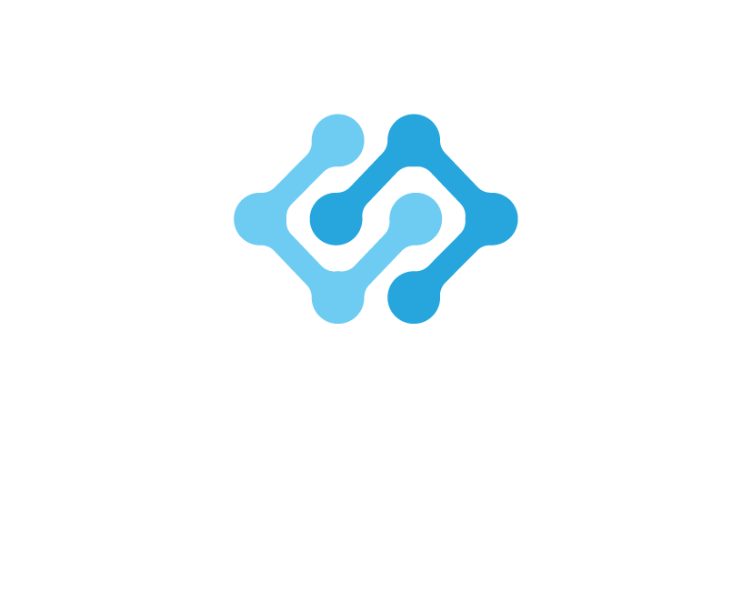

# DETANGLE

**Project:** 101249446 — DIGITAL-ECCC-2024-DEPLOY-CYBER-07

  

DETANGLE helps EU stakeholders implement and reinforce cybersecurity legislation — including the NIS2 Directive, the Cyber Resilience Act (CRA), and related certification frameworks — in a practical, cost-effective way.

National authorities often lack capacity to supervise and enforce effectively, and organisations (especially SMEs) face heavy compliance and operational costs. DETANGLE addresses this by offering a set of integrated services, built on mature foundations, and supported by training, documentation, and awareness activities toward a more resilient EU.

## Offerings (DoA)

1. **Integrated Incident Management Platform** — centralised incident handling with AI-supported threat detection and prioritisation, cross-Member State collaboration, cost-optimisation support, and post-incident analytics.
2. **NIS2 Compliance Tracker** — modular support for monitoring and achieving NIS2 compliance, including gap analysis, progress visibility, incident reporting support, and related training.
3. **EU-Wide Cybersecurity Collaboration Hub** — situational awareness, cooperation, and resilience through threat intelligence sharing, collaborative crisis simulation, and resource pooling across nations.
4. **Cybersecurity Certification Support Framework** — tools and guidance to streamline certification and encourage secure-by-design adoption, including pre-certification assessment and risk notification support.
5. **CRA Supervision & Enforcement Toolkit** — support for market surveillance and notifying bodies, including compliance checks and accreditation workflows.

This organization hosts engineering work for both **WP3** and **WP4** offerings above.

## WP3 — Multi-level compliance & certification tracking, supervision and enforcement

Goals (DoA):

- design and deploy NIS2 gap analysis and compliance tracking mechanisms
- facilitate pre-certification assessments and risk notifications
- enable CRA compliance enforcement checks and customised accreditation workflows
- deliver the DETANGLE intelligent repository: a certification-focused Knowledge Base and customised training modules

## WP4 — Enabling intelligent incident management and multi-stakeholder, cross-border collaboration

Goals (DoA):

- deploy mechanisms for AI-fuelled incident detection and incident-driven scenario building for simulations
- facilitate multi-stakeholder collaboration and incident sharing via responsible disclosure tools
- enable cost optimisation and resource pooling at pan-European level
- deliver best practices for trustworthiness and cross-border collaboration

## Consortium

DETANGLE is delivered by a multi-partner consortium under the Digital Europe Programme. Repositories in this organization support collaborative development of the WP3 and WP4 offerings described in the Description of the Action.
